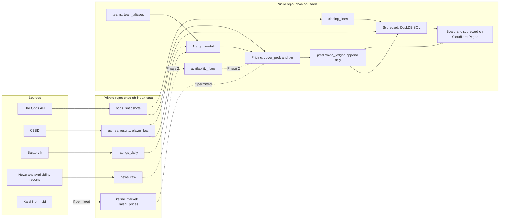

# Architecture

Shac SB Index is a set of plain Python jobs that run on GitHub Actions and write files. There is no server and no hosted database. DuckDB reads the files directly when a query needs them.

Two repos:

- **`shac-sb-index` (public):** code, docs, our own team-name map, the predictions ledger, scorecard outputs and the site.
- **`shac-sb-index-data` (private):** raw copies of everything fetched from someone else (odds snapshots, CBBD pulls, Torvik files, news text) and the tables built straight from them. The sources' terms don't allow republishing their data as a dataset, so it stays here.

Jobs in the public repo check out the private repo with a token, read and write there, and publish only derived numbers.

## Data flow

## Conventions

- **Time:** every timestamp is stored in UTC as ISO 8601 with a `Z`. Column names end in `_at`. The site converts to local time for display only.
- **Season:** an integer, the year the season ends. 2026-27 is `2027`. Torvik uses the same convention.
- **Margin:** always the home margin, home points minus away points. Positive means the home team won. Neutral-site games still have a listed home team; `neutral_site` marks them.
- **Lines:** stored as the home spread the way a book shows it (`home_spread = -6.5` means the home team is favored by 6.5). The market's implied home margin is `-home_spread`.
- **Edge:** `model_margin - market_implied_home_margin`. Positive means the model likes the home side.
- **Team IDs:** one canonical `team_id` per team, equal to CBBD's numeric team `id`. Every other source's name maps to it through `team_aliases`.
- **Game IDs:** `game_id` is CBBD's game `id`.

## The no-leakage contract

1. Every feature row carries `as_of`, the moment the information was available.
2. A feature may be used for a game only if `as_of < tip_at`.
3. A Torvik Time Machine file dated D counts every game played on D, late West Coast and Hawaii games included, so it is known at 06:00 US Eastern on D+1. A game uses the latest file whose `as_of` is before its tip (rule 2). Each season's first file must show every team at 0-0; rows that don't are dropped. Tested in task 1.4: see `docs/TORVIK.md`.
4. In backtests, a season's games are predicted by a model trained only on earlier seasons. Calibration is fit only on those earlier seasons too.
5. Nothing computed from a game's own result, or from any later game, can reach that game's features. This includes season-end ratings, final rosters and closing lines.

Tests enforce this. `tests/test_no_leakage.py` (G1) fails if any feature row has `as_of >= tip_at`, and if the feature builder's output for a game changes when later games are removed from its input. Its synthetic half runs in CI; its real-data half runs locally with `SHAC_DATA_DIR` set to the private repo (24 cutoffs, three per season, plus a record-clock check that no chosen file already counts its game).

## Data contracts

"Writer" is the only job allowed to write the table. Tables are parquet unless noted. Keys are marked **PK**.

### Public repo

**`teams`** (`data/teams.csv`). Writer: `build_teams`, then hand-reviewed.

| Column | Type | Notes |
| --- | --- | --- |
| `team_id` **PK** | int | CBBD team id |
| `name` | text | Our display name |
| `conference` | text | Current conference |
| `first_season`, `last_season` | int | D-I seasons covered, inclusive |

**`team_aliases`** (`data/team_aliases.csv`). Writer: hand-maintained, checked by a test.

| Column | Type | Notes |
| --- | --- | --- |
| `source` **PK** | text | `cbbd`, `torvik`, `odds_api`, `kalshi`, `news` |
| `alias` **PK** | text | The exact string the source uses |
| `valid_from_season` **PK** | int | First season the alias applies |
| `valid_to_season` | int, nullable | Null = still in use |
| `team_id` | int | Must exist in `teams` |

Test: every team name in every source for every season resolves to exactly one `team_id`, and no two teams share an alias in the same season.

**`closing_lines`** (private repo, `tables/closing_lines.parquet`; moved from the public list on 2026-11-10 because the `cbbd` rows are CBBD data). Writer: `shac.tables.build`. Only derived numbers built from it (CLV, distance to the close) are published.

| Column | Type | Notes |
| --- | --- | --- |
| `game_id` **PK** | int | |
| `source` **PK** | text | `own_snapshots` (median of US books), `pinnacle`, or `cbbd` |
| `close_home_spread` | float | Median across books in the last snapshot before tip |
| `close_snapshot_at` | timestamp, nullable | Fetch time of that snapshot; null for `cbbd`, which has no timestamps |
| `minutes_before_tip` | int, nullable | How stale our "close" is; null for `cbbd` |
| `basis` | text | How the close was formed: `median_us_books`, `pinnacle`, `draftkings` or `median_cbbd_providers` |
| `n_books` | int | Books in the median |
| `open_home_spread` | float, nullable | Median in the first snapshot that had the game |
| `open_snapshot_at` | timestamp, nullable | |

Only a consensus number is published, never a per-book table. For backtest seasons the source is `cbbd`, and its meaning (true close or last captured) is recorded in `docs/VERIFIED.md` once tested.

**`predictions_ledger`** (`ledger/season=YYYY/ledger.csv`). Writer: the pricing job. Append-only.

The columns below are what PR #27 built. Task 1.10 replaces them with schema v2 in [LEDGER.md](LEDGER.md) (2026-11-12), which also covers the two pricing runs, grading and the gaps in the append-only check. No ledger file exists yet.

| Column | Type | Notes |
| --- | --- | --- |
| `game_id` **PK** | int | |
| `run` **PK** | text | `morning` or `late` |
| `priced_at` **PK** | timestamp | When the row was computed; must be before `tip_at` |
| `tip_at` | timestamp | Scheduled tip when priced |
| `home_team_id`, `away_team_id` | int | |
| `model_version` | text | Git tag or short commit of the model |
| `model_margin` | float | Predicted home margin |
| `line` | float | Home spread used for pricing |
| `book` | text | `consensus` or a book key |
| `line_snapshot_at` | timestamp | Fetch time of the snapshot the line came from |
| `kalshi_implied_margin` | float, nullable | Null while Kalshi is on hold |
| `cover_prob` | float | Calibrated probability that the model's side covers |
| `side` | text | `home` or `away` |
| `tier` | text | `pick`, `lean` or `none` |
| `flags` | text | Semicolon-separated: `questionable_player`, `stale_line`, `no_ratings`, `kalshi_unexplained_move`, ... |

Integrity rules:

- Rows are only ever added. `tests/test_ledger_append_only.py` compares the ledger with the version on `main` and fails if any existing row is changed, reordered or missing. It runs in CI on every PR and at the start of every pricing job. CI fetches `main` for it, and in CI a missing `main` fails the test rather than skipping it. Rows are written only through `shac.ledger.writer.append_rows`, which checks every row first and writes nothing if one fails, opens the file in append mode, refuses a game that tipped before the write, and refuses a duplicate (`game_id`, `run`, `priced_at`).
- A row is written only if `priced_at < tip_at`. The job refuses to price a game that has started.
- The commit that adds a row is the public timestamp. Commits go straight to `main`.
- If the morning and late runs disagree, the last row with `priced_at < tip_at` is the one scored. Both stay on record.
- Results are never written into the ledger. The scorecard joins results at query time.

**`availability_flags`** (Phase 2; `data/availability_flags.parquet`). Writer: the extraction job.

| Column | Type | Notes |
| --- | --- | --- |
| `flag_id` **PK** | text | Hash of `news_id` + `athlete_id` |
| `news_id` | text | The `news_raw` item it came from |
| `game_id` | int, nullable | Game it applies to, if known |
| `team_id` | int | |
| `athlete_id` | int, nullable | CBBD athlete id, null if not matched |
| `player_name` | text | As written in the source |
| `status` | text | `out`, `doubtful`, `questionable`, `probable`, `available` |
| `is_change` | bool | True if this is new information, not a long-running absence |
| `source_type` | text | `official_report` or `news` |
| `as_of` | timestamp | The item's `fetched_at` |
| `extracted_at` | timestamp | |
| `model` | text | LLM model id |
| `prompt_version` | text | |
| `confidence` | float | Model-reported, 0 to 1 |

Player names and statuses are short facts, not source text, so this table is public. The text it was read from stays private.

### Private repo

**`odds_snapshots`** (`odds/raw/YYYY/MM/DD/odds_<stamp>.json.gz`). Writer: `shac.snapshots.odds`, 12 times a day. One file per fetch: the full response data as JSON, wrapped with `fetched_at`, the request parameters and the credit counts. Files are never overwritten. A flattened view is built on read:

| Column | Type | Notes |
| --- | --- | --- |
| `snapshot_at` **PK** | timestamp | `fetched_at` of the file |
| `odds_event_id` **PK** | text | The Odds API event id |
| `book` **PK** | text | Bookmaker key |
| `commence_at` | timestamp | Tip time per the feed |
| `home_team`, `away_team` | text | Source names; mapped through `team_aliases` |
| `home_spread` | float | |
| `home_price`, `away_price` | int | American odds |
| `market_last_update_at` | timestamp | When the book's spread last changed, per the feed |
| `game_id` | int, nullable | Filled after matching to `games` |

Each run also appends one row to `data/status/odds_snapshot_log.csv` in the public repo: fetch time, game count, book count, credits left and the file's SHA-256. That log is the public proof the snapshot existed at that time, without exposing the data. If the file could not be pushed to the private repo, the log gets a `push_failed` row, so the public record never claims a snapshot that was lost.

**`games`**. Writer: `ingest_cbbd`.

| Column | Type | Notes |
| --- | --- | --- |
| `game_id` **PK** | int | |
| `season` | int | |
| `season_type` | text | Regular, postseason, ... |
| `tip_at` | timestamp | |
| `tip_tbd` | bool | |
| `home_team_id`, `away_team_id` | int | |
| `neutral_site`, `conference_game` | bool | |
| `status` | text | Scheduled, final, cancelled, ... |
| `fetched_at` | timestamp | |

**`results`**. Writer: `ingest_cbbd`.

| Column | Type | Notes |
| --- | --- | --- |
| `game_id` **PK** | int | |
| `home_points`, `away_points` | int | |
| `home_margin` | int | `home_points - away_points` |
| `overtimes` | int | |
| `fetched_at` | timestamp | |

**`player_box`**. Writer: `ingest_cbbd`. Ground truth for who played.

| Column | Type | Notes |
| --- | --- | --- |
| `game_id` **PK** | int | |
| `team_id` **PK** | int | |
| `athlete_id` **PK** | int | |
| `player_name` | text | |
| `minutes` | float | 0 or missing = did not play |
| `starter` | bool | |
| `fetched_at` | timestamp | |

**`game_history`** (`tables/game_history.parquet`). Writer: `shac.tables.build` (`sql/tables/game_history.sql`). One row per game in `games`. The only table the baseline and the model read history from.

| Columns | Group | Notes |
| --- | --- | --- |
| `game_id` **PK**, `season`, `season_type`, `tip_at`, `tip_tbd`, `neutral_site`, `conference_game`, `home_team_id`, `away_team_id` | Key | From `games` |
| `ratings_source`, `rating_date`, `ratings_as_of`, `file_n_teams`, `file_mean_tempo` | Feature | The ratings file used: the latest of the game's season with `as_of < tip_at`. `file_mean_tempo` is the mean `adj_tempo` of every team in that file |
| `home_adj_o`, `home_adj_d`, `home_adj_tempo`, `home_barthag`, `home_rank`, and the same for `away_` | Feature | Both teams from that one file (same source, date and `as_of`, so two pulls on one date never mix). A team missing from it gets empty ratings, never an older file |
| `status`, `home_points`, `away_points`, `home_margin`, `overtimes` | Label | From `games` (status is only final after the game) and `results` |
| `cbbd_close_home_spread`, `cbbd_open_home_spread`, `cbbd_close_basis`, `own_close_home_spread`, `pinnacle_close_home_spread` | Benchmark | From `closing_lines`. Never a feature (rule 5) |

The column groups are listed in `src/shac/tables/history.py`; only feature columns may feed a prediction.

**`rotation_players`** (`tables/rotation_players.parquet`). Writer: `shac.tables.build` (`sql/tables/rotation_players.sql`). The G2 ground truth: who was a rotation player before each game, and whether they played. One row per game, team and player already listed for that team earlier in the season.

| Column | Group | Notes |
| --- | --- | --- |
| `game_id`, `team_id`, `athlete_id` **PK**, `season`, `tip_at`, `player_name` | Key | |
| `team_games_before`, `games_played_before`, `minutes_before`, `mpg_before` | Point in time | From the team's earlier games that season only. `mpg_before` = minutes / games played (minutes > 0) |
| `games_sat_in_a_row_before` | Point in time | Team games in a row the player sat just before this one; 0 = played last game. Separates new absences from long-running ones |
| `rotation_rank`, `is_rotation` | Point in time | Rank by `mpg_before` (ties: more minutes, then lower `athlete_id`); rotation = top 8 (PREREGISTRATION.md) |
| `played`, `minutes`, `starter` | Outcome | This game's box score. A player not listed sat (0 minutes) |

Only final D-I vs D-I team-games with a box score are included; a team's first game of a season has no rows.

**`ratings_daily`**. Writer: `ingest_torvik`. Point-in-time.

| Column | Type | Notes |
| --- | --- | --- |
| `rating_date` **PK** | date | The date in the file name (Time Machine), or the US Eastern date of our pull (daily) |
| `season` | int | Season (ending year) |
| `team_id` **PK** | int | |
| `source` **PK** | text | `torvik_time_machine` (backfill) or `torvik_daily` (our own daily pull) |
| `adj_o`, `adj_d`, `adj_tempo` | float | Adjusted offense, defense, tempo |
| `barthag` | float | Torvik's power rating |
| `rank` | int | |
| `wins`, `losses` | int | Record to date, as Torvik counts it (used to test timing) |
| `as_of` | timestamp | When these ratings were known. For our daily pulls, the fetch time. For the Time Machine backfill, 06:00 US Eastern on the day after `rating_date` (no-leakage rule 3). |
| `fetched_at` | timestamp | |

**`news_raw`** (`news/raw/google_news/YYYY/MM/DD/google_news_<stamp>.json.gz`). Writer: `shac.news.google_news` (twice a day, `news-collect.yml`). One file per run: for each team searched, the query, the raw RSS XML and the parsed items (guid, title, outlet, link, publish time). Headlines only; article pages are never fetched. Team-site feeds (the secondary source, `shac.news.sidearm`, daily, `news-sidearm.yml`) go to `news/raw/sidearm/YYYY/MM/DD/sidearm_<stamp>.json.gz` in the same shape, with each item's summary too. A flattened table with the columns below is built later, for G2.

| Column | Type | Notes |
| --- | --- | --- |
| `news_id` **PK** | text | Hash of source + URL + content |
| `source` | text | Feed or report name |
| `url` | text | |
| `title`, `text` | text | As fetched |
| `published_at` | timestamp, nullable | Per the source |
| `fetched_at` | timestamp | Ours; this is the `as_of` |

**`kalshi_markets`, `kalshi_prices`** (on hold; nothing is collected until Kalshi gives written permission).

| Table | Columns |
| --- | --- |
| `kalshi_markets` | `market_ticker` **PK**, `event_ticker`, `game_id`, `team_id` (the team "yes" refers to), `is_home`, `strike` (yes = team wins by more than this), `open_at`, `close_at`, `fetched_at` |
| `kalshi_prices` | `market_ticker` **PK**, `price_at` **PK**, `yes_bid`, `yes_ask`, `last_price`, `volume`, `open_interest`, `fetched_at` |

## Pricing

1. **Margin:** the model predicts `model_margin` (home) from point-in-time ratings and game context.
2. **Edge:** `model_margin - (-line)`.
3. **Side:** home if the edge is positive, away if negative.
4. **Cover probability:** a calibration curve maps the size of the edge to how often that side actually covered. It is fit on training seasons only (see PREREGISTRATION.md). The raw normal formula, Φ(edge / σ), overstates confidence and is not used for tiers.
5. **Tier:** `pick`, `lean` or `none` from the cutoffs in PREREGISTRATION.md, then the caps (questionable rotation player caps at Lean; the Kalshi check applies to Picks when Kalshi data is allowed).

## Kalshi conversion (designed, switched off)

A Kalshi spread market is a yes/no contract: "Team T wins by more than k." Each game lists many strikes k for both teams.

Treat the margin as normal with mean μ and spread σ. For a market on team T at strike k with yes-probability p:

- If T is the home team: `p = 1 - Φ((k - μ) / σ)`, so `μ = k + σ·Φ⁻¹(p)`.
- If T is the away team, "away wins by more than k" means the home margin is below `-k`: `p = Φ((-k - μ) / σ)`, so `μ = -k - σ·Φ⁻¹(p)`.

μ is the Kalshi-implied home margin.

- **Probability used:** the mid price, `(yes_bid + yes_ask) / 2`, from markets with quotes on both sides and a spread no wider than 10¢.
- **Several strikes:** first put every strike on the same footing, as "the home margin is above t" with probability q. A home-team strike gives `t = k, q = p`. An away-team strike gives `t = -k, q = 1 - p`. Then `Φ⁻¹(q) = (μ - t) / σ`. When a game has three or more usable strikes with q between 0.10 and 0.90, fit a straight line of `Φ⁻¹(q)` against t: the slope is `-1/σ` and the intercept is `μ/σ`. That gives μ and the market's own σ for the game. With fewer, use the single strike nearest q = 0.50 and the pre-registered σ.
- **Fee-adjusted price for the Pick check:** the cost to take a side is `ask + fee`, with `fee = 0.07 × ask × (1 − ask)` per contract. A Pick must have `cover_prob` above that cost for the matching side and strike. The 0.07 constant is unverified against Kalshi's official fee schedule; confirm it before this check goes live.
- **Home/away:** Kalshi has no home/away field. `is_home` comes from matching the market's team to our `games` table through `team_aliases`.

## Secrets

All in GitHub Actions secrets on `shac-sb-index`. None are ever committed. Local runs read a gitignored `.env`.

| Secret | Used by | Notes |
| --- | --- | --- |
| `ODDS_API_KEY` | Odds snapshot job | The Odds API, free tier |
| `CBBD_API_KEY` | CBBD ingestion | Free tier, 1,000 calls a month shared with the football API |
| `DATA_REPO_TOKEN` | Every job that reads or writes raw data | Fine-grained token: `shac-sb-index-data` only, Contents read and write |
| `ANTHROPIC_API_KEY` | Phase 2 extraction | Not needed until G2 |

Workflows never print secrets or raw data, and never run with shell tracing on. Public repo logs are public.

## Jobs

| Job | Schedule (UTC) | Reads | Writes |
| --- | --- | --- | --- |
| Odds snapshot | 7 a day at :17 (13, 16, 19, 21, 23, 1, 3), US books plus Pinnacle | The Odds API | `odds_snapshots`, public status log |
| Torvik daily snapshot | 11:43 | Barttorvik CSV files | Raw Torvik files, public status log |
| Snapshot watch | 23:47 and 05:47 | Public status log | Nothing. Fails, and GitHub emails Owen, if the newest scheduled odds slot that is over 3 hours old has no good snapshot |
| CBBD ingestion (G1) | Nightly | CBBD | `games`, `results`, `player_box` |
| Pricing, morning and late (G1) | Morning, and about 2 hours before the day's tips | Ratings, latest snapshot | `predictions_ledger` |
| Results and scorecard (G1) | Nightly | Ledger, results, closing lines | `closing_lines`, scorecard outputs, site data |
| News collection (G1) | A few times a day | Permitted feeds | `news_raw` |

GitHub cron can run 5 to 30 minutes late and sometimes skips a run, so no job depends on exact timing. Every file records its own fetch time.
